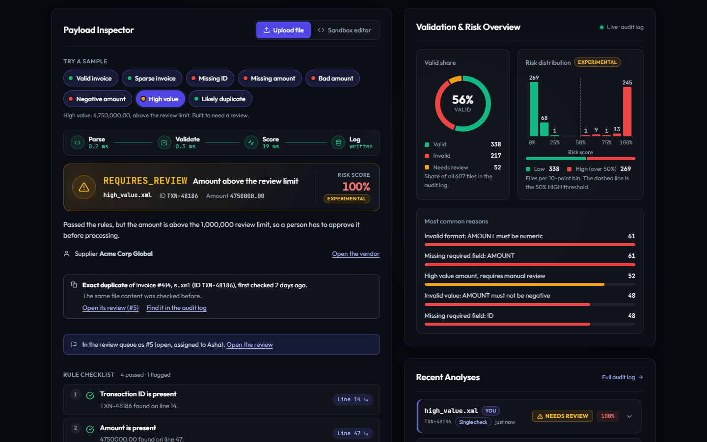
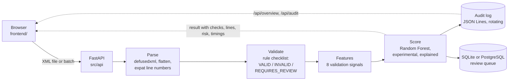

# SupplyTrace

**Checks supplier XML invoices with deterministic rules, marks the failing lines, and adds an experimental ML risk score.**

Validate nested supplier XML invoices (UBL-style) with deterministic rules that label each file `VALID`, `INVALID` or `REQUIRES_REVIEW`, point every rule at the line of the file behind it, add an experimental risk score from a small Random Forest, and track every result on a web dashboard backed by a JSON Lines audit log.

Bad invoice data rarely fails where it arrives. It fails later, several systems downstream, where it is hard to trace back to the file that caused it. SupplyTrace checks each file at the door.

[](https://github.com/vishnuatgit/SupplyTrace/actions/workflows/ci.yml)

[](LICENSE)

## Live demo

**[supplytrace-fkpq.onrender.com](https://supplytrace-fkpq.onrender.com)** (free hosting: the first visit can take about a minute to wake it up). Try **Batch → Check the 8 sample invoices**.

Pick one of the sample invoices (valid, sparse, missing ID, missing amount, bad amount, negative amount, high value), drop your own XML file (up to 1 MB), edit XML in the sandbox, or check a batch of up to 20 files. The demo runs on Render's free tier, which puts the service to sleep after 15 minutes without traffic, so the first request after a quiet spell can take up to a minute.

Everything in the demo is synthetic: the dashboard starts from a batch of 400 generated invoices and the risk model is trained on them. Please don't upload real invoices.



More screenshots: [dashboard](docs/screenshots/home.png), [batch check of the seven samples](docs/screenshots/cover.png), [mobile result](docs/screenshots/mobile.png).

## What it does

1. **Parse safely.** The upload is parsed in memory with `defusedxml` (no DTDs, so no entity expansion or external entities), documents nested more than 100 levels deep are rejected, and uploads over 1 MB get a `413` before the body is read. The nested XML is flattened into dot-notation keys such as `Invoice.LegalMonetaryTotal.PayableAmount`, and a second, lightweight `expat` pass records the line of every element.
2. **Validate with rules.** The transaction ID and the amount are found wherever they sit, and five deterministic rules decide the status. Every rule comes back as a checklist row (passed, failed, needs review or not checked) with the line that shows it.
3. **Score the risk (experimental).** Eight validation signals go to a Random Forest trained on the synthetic batch. The score comes with what drove it: the training base rate plus one contribution per feature.
4. **Log it.** One JSON line per file goes to a rotating audit log, which also feeds the dashboard.

Every user and system flow is written up, with diagrams, in **[docs/process-flows.md](docs/process-flows.md)**.

## Features

- **Dashboard.** A KPI ribbon (files analysed, invalid rate, average risk, high-risk flags), a valid-share ring, a risk histogram split by flag, the most common reasons and a Recent Analyses feed, all computed by the server from the audit log. It refreshes every 30 seconds while it is on screen (a failed refresh keeps the last numbers and says how old they are), and the visitor's own checks are tagged **You** in the shared feed.
- **Payload Inspector.** One-click sample invoices, drag-and-drop upload, and a sandbox editor with line numbers and Ctrl+Enter to check.
- **Live "How it works" pipeline.** Parse, Validate, Score and Log light up while a check runs, in the panel at the top and in a compact strip inside the inspector where the result appears, and settle with the time the server measured for each stage.
- **Results you can act on.** A verdict banner, a rule-by-rule checklist where clicking a rule jumps to and highlights its line, the XML with syntax colours, line numbers and marked lines, the risk score with a waterfall of what drove it, and a JSON report download.
- **Malformed XML points at the break.** A file that is not well-formed gets the line, column and reason from the parser. The page marks that line, and Fix in sandbox opens the file with the caret on it, the reason above the editor and the line marked until the next edit.
- **Batch check.** Up to 20 files of up to 1 MB, streamed back one by one: each file's row fills in as soon as the server has checked it, with a real progress bar. Then summary tiles, a status bar, a risk strip plot, the rules broken, a sortable table, a drawer to drill into any file (previous and next follow the table's sort), and CSV or JSON downloads. A file that cannot be read is listed as `REJECTED` instead of failing the batch, and a batch cut off by the network can be retried as it was.
- **Review queue.** Invoices above the review limit are queued automatically, and an invalid one can be sent from its result. Assign a reviewer, comment, approve or reject (a comment is required), and see the full append-only history per invoice, next to the rule checklist and risk explanation the check produced. Walkthrough: [docs/walkthroughs/01-review-workflow.md](docs/walkthroughs/01-review-workflow.md); what is planned and what was dropped: [docs/roadmap.md](docs/roadmap.md).
- **Duplicate detection.** Every analysed invoice is fingerprinted (SHA-256 of the file) and its supplier, ID, date and amount recorded. The same file again is an **exact** duplicate; a different file with the same supplier and ID, or the same supplier and amount within 7 days, is a **likely** duplicate and goes to the review queue. The flag, the reason and the earlier invoice show in single and batch results, the review page and the audit log. Walkthrough: [docs/walkthroughs/02-duplicate-detection.md](docs/walkthroughs/02-duplicate-detection.md).
- **Vendor directory.** Every supplier seen in the checked invoices, with invoice count, status breakdown, total and average amount (per currency), duplicates flagged, average risk and last seen, a list of its invoices, editable notes and a **trusted** flag. The trusted flag is shown on results and written to the audit log, and never changes validation. Walkthrough: [docs/walkthroughs/03-vendor-directory.md](docs/walkthroughs/03-vendor-directory.md).
- **Audit log.** Filter by status and source, search file names and transaction IDs, open and copy the exact JSON line, export what is shown.
- **Rules and model card.** Each rule with an example that breaks it (the tests run every example through the real pipeline), and a model card whose numbers the server computes at startup.
- **Dark and light themes**, keyboard access, visible focus, screen-reader announcements, reduced-motion support and no horizontal scrolling down to 360 px.

## Validation rules

| Rule | Broken when | Example | Result |
|:--|:--|:--|:--|
| Transaction ID is present | No non-empty `TransactionID`, `InvoiceID` or `DocumentID`, and no plain `ID` within 3 levels of the root | an invoice with only a bank-account `ID` | `INVALID` |
| Amount is present | No non-empty `PayableAmount`, `TotalAmount`, `InvoiceAmount`, `Amount` or `Total` | `<PayableAmount/>` | `INVALID` |
| Amount is a number | The amount is not a plain decimal number | `12,50.00`, `USD 300.00`, `N/A` | `INVALID` |
| Amount is not negative | The amount is below zero | `-2867.70` | `INVALID` |
| Amount is within the review limit | The amount is above 1,000,000 (checked only when the others pass) | `4750000.00` | `REQUIRES_REVIEW` |

The rules are defined once in [`src/validation/rules.py`](src/validation/rules.py), where `Validator.checklist()` decides every rule's state and the status is derived from it, and they are served by `GET /api/rules`.

## Risk model (experimental)

The status comes from the rules. The risk score is there to show a small ML component end to end, honestly: it is trained on synthetic data and says nothing about real suppliers.

- **Data.** [`src/pipeline/synthetic.py`](src/pipeline/synthetic.py) writes 400 UBL-style invoices from a fixed seed: 65% valid and 7% each missing the ID, missing the amount, with a non-numeric amount, with a negative amount, or above the review limit. Independently, 40% may leave optional fields out and 20% are wrapped in a transport envelope.
- **Label.** A simulated downstream outcome. A file that breaks a rule or needs review always fails. Any other file fails with probability 2% + 4% per missing optional field + 3% if the amount is 100,000 or more + 3% if it is wrapped, capped at 20%.
- **Features.** Missing ID, missing amount, non-numeric amount, negative amount, amount above the review limit, amount of 100,000 or more, number of missing optional fields (issue date, currency, supplier, payment account) and nesting depth. File size is shown but deliberately not used. The pipeline compiles these into a standardized feature matrix (`results/results.csv`).
- **Model.** `RandomForestClassifier(n_estimators=100, max_features=None, min_samples_leaf=10, random_state=42)`, trained by the server at startup. A score above 50% is flagged `HIGH`.
- **Explanation.** `RiskPredictor.explain()` follows each tree from its root to the file's leaf and credits every split's change in failure rate to the feature it tested. Averaged over the forest, the base rate plus the contributions equals the score; the page draws it as a waterfall.
- **Holdout evaluation.** The server trains a fresh model on 300 of the 400 invoices and tests it on the other 100 (stratified split, seed 42), next to a rules-only baseline that says a file fails exactly when its status is not `VALID`. These are the numbers it computes (the live values are on the Rules & model page and at `GET /api/model`):

  | Metric (100 held-out files, 45 failed) | Model | Rules only |
  |:--|--:|--:|
  | Accuracy | 0.96 | 0.96 |
  | Precision (failed) | 1.00 | 1.00 |
  | Recall (failed) | 0.91 | 0.91 |
  | ROC AUC | 0.97 | 0.96 |

  At the 50% threshold the model makes the same call as the rules on every held-out file. Its only extra information is how it orders the files the rules pass: ROC AUC 0.70 on 59 valid test files, only 4 of which failed, which is too few to rely on. And because the labels are generated from the same signals the model sees, these numbers show that it recovers the simulation, not that it predicts real outcomes.

## Architecture



A single check (`POST /api/analyze`), a batch (`POST /api/analyze/batch`) and a streamed batch (`POST /api/analyze/batch/stream`) call the same `analyze_document()`, so a file gets the same answer every way (tests compare them). On startup the server makes sure the synthetic batch exists, runs it through the same components (the batch pipeline writes `results.csv`, `powerbi_summary.csv` and audit entries) and trains the model on it. More detail: [docs/architecture.md](docs/architecture.md) and [docs/process-flows.md](docs/process-flows.md).

## Tech stack

| Layer | Choice |
|:--|:--|
| API | Python 3.11+, FastAPI, Uvicorn |
| XML | `defusedxml`, Python's `expat` (line numbers) |
| Data and model | pandas, NumPy, scikit-learn |
| Storage | SQLAlchemy Core: SQLite by default, PostgreSQL through `DATABASE_URL` |
| Frontend | HTML, CSS, JavaScript modules, hand-drawn SVG charts; Outfit and JetBrains Mono from Google Fonts |
| Quality | pytest, pytest-cov, Ruff, GitHub Actions (Python 3.11 and 3.12) |
| Hosting | Render (Blueprint in `render.yaml`) |

## Run locally

```bash
git clone https://github.com/vishnuatgit/SupplyTrace.git
cd SupplyTrace
python -m venv .venv
# Windows: .venv\Scripts\activate    Linux/macOS: source .venv/bin/activate
pip install -r requirements.txt
python -m src.api.server             # http://127.0.0.1:8000
```

Open http://127.0.0.1:8000 and click a sample, drag a file from `data/raw_xml/` onto the upload area, or use the **Sandbox editor** tab. Interactive API docs are at http://127.0.0.1:8000/docs.

On the first start the server generates the synthetic dataset and runs the batch pipeline, which takes a few seconds. The same two steps can be run by hand:

```bash
python -m scripts.generate_data      # 400 synthetic invoices + outcomes.csv in data/raw_xml/ (fixed seed)
python -m scripts.run_pipeline       # validates them, trains the model, writes results/
```

`generate_data` replaces any XML files already in `data/raw_xml/`.

### Configuration

All settings are optional environment variables. Relative paths are resolved against the working directory.

| Variable | Default | Purpose |
|:--|:--|:--|
| `SUPPLYTRACE_RESULTS_DIR` | `results` | Batch results (`results.csv`, `powerbi_summary.csv`). |
| `SUPPLYTRACE_DATA_DIR` | `data/raw_xml` | Where the startup bootstrap writes the synthetic invoices. |
| `SUPPLYTRACE_AUDIT_DIR` | same as results | Directory for `audit_log.jsonl`. |
| `SUPPLYTRACE_AUDIT_MAX_BYTES` | `1000000` | Size at which the audit log is rotated to `audit_log.jsonl.1`. |
| `SUPPLYTRACE_MAX_UPLOAD_BYTES` | `1000000` | Largest accepted file, for single and batch checks. The frontend checks the same 1 MB limit before uploading. |
| `SUPPLYTRACE_BOOTSTRAP` | `1` | Set to `0` to skip generating the demo dataset (and the sample reviews) on startup. |
| `SUPPLYTRACE_DB_PATH` | `data/supplytrace.db` | SQLite file for the review queue. |
| `DATABASE_URL` | unset | Use another database instead, for example a free PostgreSQL on Neon (also install a driver such as `psycopg2-binary`). On Render's free tier the disk is ephemeral, so with SQLite the reviews reset on every redeploy. |

The dev server (`python -m src.api.server`) listens on `127.0.0.1:8000` with auto-reload; in production run `uvicorn src.api.server:app --host 0.0.0.0 --port <port>`.

## Tests

```bash
pip install -r requirements-dev.txt
python -m pytest                     # unit and integration tests, with coverage
ruff check . && ruff format --check .
```

The suite covers XML parsing and safety (DTDs, entity expansion, depth, size limits, empty files, parse-error positions), every validation rule, the rule checklist and every example on the rules page, line locating, the risk explanation (it must add up to the score), the single, batch and streamed endpoints (including that they agree and report the audit timestamp they wrote), the audit log, its filters and the dashboard overview, the review workflow (state transitions, API and an end-to-end run), duplicate detection with crafted invoices, the vendor statistics and the trusted flag (which must not change a result), the model card's holdout metrics, and the frontend's security headers. The tests use FastAPI's `TestClient` and temporary directories; they need no network and never write to the repository's `data/` or `results/`. CI runs the same commands on every push.

## Deploy on Render

The repository includes a [Render Blueprint](render.yaml) for a free web service:

1. Push the repository to GitHub.
2. In the Render dashboard choose **New > Blueprint**, select the repository and apply `render.yaml`.
3. When the deploy finishes, open the service URL and put it under [Live demo](#live-demo).

The Blueprint uses these settings, which can also be entered by hand for a plain web service:

| Setting | Value |
|:--|:--|
| Runtime | Python, `PYTHON_VERSION=3.11.9` |
| Plan / region | Free / Singapore |
| Build command | `pip install -r requirements.txt && python -m scripts.generate_data && python -m scripts.run_pipeline` |
| Start command | `uvicorn src.api.server:app --host 0.0.0.0 --port $PORT` |
| Health check path | `/healthz` |

The environment variables in [Configuration](#configuration) can be added in the service's **Environment** settings; the defaults suit the demo. Render's free disk is ephemeral: the synthetic batch is generated during the build, the server regenerates it on startup if it is missing, and the audit log is reset on every restart or redeploy.

## API overview

| Method | Path | Description |
|:--|:--|:--|
| `POST` | `/api/analyze` | Multipart upload (`file`, must end in `.xml`, up to 1 MB). Returns `filename`, `id`, `status`, `errors`, `findings` (each broken rule with `line`, `end_line` and a `note`), `checks` (all five rules with `state`, `outcome`, `line` and `note`), `fields` (where the ID and amount were found), `features`, `prediction` (`risk_score`, `risk_flag`, or `"N/A"` without a model), `risk_drivers` (`base` and per-feature `contributions` in percentage points), `processing_ms`, `timings_ms` (`parse`, `validate`, `score`, `locate`), `logged` and `logged_at` (the audit entry's timestamp). `400` for a non-XML name, an empty file, a DTD, too-deep nesting or malformed XML (the body then also has `line`, `column` and `reason`); `413` for a file over the limit. |
| `POST` | `/api/analyze/batch` | Multipart upload of up to 20 `files`. Returns `count`, a per-status `summary` and `results` in the same shape as `/api/analyze`; a file that cannot be read gets status `REJECTED` with the reason (and `parse_error` for malformed XML). `400` for more than 20 files; `413` for a request body over the batch limit. |
| `POST` | `/api/analyze/batch/stream` | The same batch as newline-delimited JSON: a `start` line, one `result` line per file as soon as it is checked, and a `summary` line. |
| `GET` | `/api/overview` | The dashboard, from the audit log: totals per status and source, valid share, invalid rate, average risk, a 10-bin risk histogram split by flag, the top reasons and the `recent` (1 to 50) newest entries. |
| `GET` | `/api/audit` | Audit log entries, newest first. Query: `status`, `origin` (`web`, `web-batch`, `pipeline`), `q` (searches file names and IDs) and `limit` (1 to 500, default 50). Returns `total`, `counts` per status, `matching` and `entries`, each with the parsed `entry` and its exact JSON `line`. |
| `GET` | `/api/rules` | The validation rules in plain language, with examples, and where the ID and amount are looked for. |
| `GET` | `/api/model` | The model card: settings, features with importances, training data and holdout metrics. |
| `GET` | `/api/samples` | The sample invoices (`id`, `label`, `filename`, `description`, `expected` status). |
| `GET` | `/api/samples/{id}` | One sample invoice as XML. |
| `GET` | `/api/stats` | Totals from the last batch run (`powerbi_summary.csv`), for BI tools. |
| `GET` | `/api/history` | The 15 most recent rows of `results/results.csv`, newest first. |
| `GET` | `/healthz` | Liveness check: `{"status": "ok"}`. |
| `GET` | `/docs` | Interactive API docs generated by FastAPI, grouped by tag. |
| `GET` | `/` | The web app (served with a strict Content-Security-Policy). |

## Project structure

```text
SupplyTrace/
├── frontend/
│   ├── index.html         the five views: check (dashboard), batch, audit log, rules and model, about
│   ├── styles.css         dark and light themes
│   ├── favicon.svg
│   └── js/
│       ├── main.js        hash router, theme toggle, wiring between views
│       ├── theme.js       applies the saved theme before the page paints
│       ├── check.js       Payload Inspector: samples, upload, sandbox editor, checking
│       ├── pipeline.js    the live "How it works" panel and the inspector's pipeline strip
│       ├── result.js      verdict, rule checklist, XML panel, risk card, report download
│       ├── xml-view.js    XML with syntax colours, line numbers and marked lines
│       ├── overview.js    KPI ribbon, charts, Recent Analyses, 30-second refresh
│       ├── charts.js      SVG charts: ring, histogram, bars, strip plot, gauge, waterfall
│       ├── batch.js       streamed batch with live rows, summary, sortable table, drawer, CSV/JSON
│       ├── audit.js       audit log filters, search, JSON lines, export
│       ├── reference.js   rules and model card
│       ├── api.js         requests, streaming, error messages, upload limits
│       └── ui.js          DOM helpers, formatting, toasts, tabs, drop zones
├── src/
│   ├── api/               server.py (endpoints, security headers), analysis.py (the single-file
│   │                      pipeline), upload_limit.py, samples/ (one-click sample invoices)
│   ├── ingestion/         xml_loader.py (safe parse, flatten), parser.py (find ID and amount),
│   │                      locator.py (line numbers)
│   ├── validation/        rules.py (the rules, the checklist and the validator)
│   ├── features/          extractor.py (risk signals)
│   ├── prediction/        model.py (RiskPredictor and its explanation), model_card.py (holdout evaluation)
│   ├── pipeline/          orchestrator.py (batch run), synthetic.py (data generator),
│   │                      bootstrap.py (startup data check)
│   ├── dashboard/         exporter.py (summary CSV for BI tools), overview.py (dashboard numbers)
│   └── utils/             audit.py (audit log writer and reader)
├── scripts/               generate_data.py, run_pipeline.py
├── tests/                 pytest suite
├── docs/                  architecture.md, process-flows.md, screenshots/
├── render.yaml            Render Blueprint for the live demo
├── requirements.txt       pinned runtime dependencies
└── requirements-dev.txt   test and lint tools
```

## Limitations

- The risk model is trained on synthetic invoices with simulated outcomes. Real use would need outcome data from the downstream system, and the scores are not calibrated probabilities.
- Five rules only: no checks on line totals, tax, dates, currencies or duplicate invoices.
- Repeated elements, such as several invoice lines, collapse to the last one when flattened, and XML attributes are ignored.
- The audit log is one shared file: every visitor sees the same log and dashboard, and on Render's free tier it resets on every restart or redeploy.
- The model is retrained at every startup; there is no saved, versioned model.
- No accounts or authentication. It is a demo, not a multi-user service.

## Author

Built by Chandana Vishnu Jayanth · [Portfolio](https://vishnuatgit.github.io) · [Case study](https://vishnuatgit.github.io/projects/supplytrace.html) ([PDF](https://vishnuatgit.github.io/pdf/supplytrace-case-study.pdf))

## License

[MIT](LICENSE) © 2026 Chandana Vishnu Jayanth
