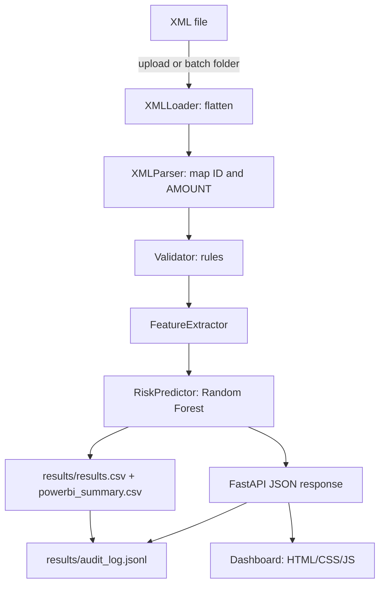

# SupplyTrace

Validate supplier XML invoices, score their processing risk with a Random Forest model, and track every result on a web dashboard.

[](https://github.com/vishnuatgit/SupplyTrace/actions/workflows/ci.yml)

[](LICENSE)

## What it does and why

Business systems exchange invoices as XML. A file that is missing its transaction ID or amount, or that carries a non-numeric amount, can pass through several hops before anything downstream fails, and by then it is hard to trace. SupplyTrace checks each file up front:

1. It flattens any nested XML (namespaces included) into dot-notation keys.
2. It finds the transaction ID and amount wherever they sit in the document.
3. It applies deterministic validation rules and labels the file `VALID`, `INVALID` or `REQUIRES_REVIEW`.
4. It extracts a few features and, if a model has been trained, returns a risk score from a Random Forest classifier.
5. It writes every analysis to a JSON Lines audit log and shows results on a dashboard.

## Features

- **Nested XML flattening**: `Invoice.LegalMonetaryTotal.PayableAmount`-style keys, with default namespaces stripped per element so parent paths are kept.
- **Field mapping**: the ID is taken from `TransactionID`, `InvoiceID` or `DocumentID` first; a generic `ID` is used only near the top of the document, so a nested bank-account `ID` is never mistaken for the transaction ID. The amount comes from `PayableAmount`, `TotalAmount`, `InvoiceAmount`, `Amount` or `Total`.
- **Validation rules**: missing ID, missing amount, or a non-numeric amount makes a file `INVALID`; an amount above 1,000,000 makes it `REQUIRES_REVIEW`.
- **Risk score**: a scikit-learn `RandomForestClassifier` gives the probability that a file is not `VALID`; above 50% is flagged `HIGH`.
- **Batch pipeline**: processes a folder of XML files and writes `results/results.csv`, a one-row `results/powerbi_summary.csv` for BI tools, and the audit log.
- **Web dashboard**: upload a file or paste XML into the sandbox editor; see KPI cards, a compliance gauge, risk distribution and recent batch results.
- **Audit log**: every analysis (batch and web) is appended to `results/audit_log.jsonl` with a UTC timestamp.

## Architecture



The FastAPI app serves both the REST API and the static frontend from `frontend/`. Stats and history on the dashboard come from the last batch run (`results/*.csv`); web uploads are returned to the browser and written to the audit log.

## Tech stack

Python 3.11+, FastAPI, Uvicorn, pandas, scikit-learn, plain HTML/CSS/JavaScript, pytest, Ruff, GitHub Actions.

## Quick start

```bash
git clone https://github.com/vishnuatgit/SupplyTrace.git
cd SupplyTrace
python -m venv .venv
# Windows: .venv\Scripts\activate    Linux/macOS: source .venv/bin/activate
pip install -r requirements.txt

python scripts/generate_data.py      # 10 sample XML files in data/raw_xml/ (fixed seed)
python -m scripts.run_pipeline       # validates them, trains the model, writes results/
python -m src.api.server             # http://127.0.0.1:8000
```

Then open http://127.0.0.1:8000, drag a file from `data/raw_xml/` onto the upload area, or use the **Sandbox Editor** tab. Interactive API docs are at http://127.0.0.1:8000/docs.

If you skip the pipeline step the app still runs; risk scores show as `N/A` because no model has been trained.

## Configuration

There are no environment variables. Paths are relative to the working directory: input files in `data/raw_xml/`, output in `results/`. The dev server listens on `127.0.0.1:8000` (see the bottom of `src/api/server.py`), or run `uvicorn src.api.server:app --port <port>`.

## Running tests

```bash
pip install -r requirements-dev.txt
python -m pytest          # unit + API tests, with coverage
ruff check . && ruff format --check .
```

The tests use FastAPI's `TestClient` and temporary directories; they need no network. `tests/test_pipeline.py` regenerates the sample data in `data/raw_xml/` and writes to `results/`.

## Project structure

```text
SupplyTrace/
├── frontend/            index.html, styles.css, app.js (dashboard)
├── scripts/
│   ├── generate_data.py synthetic UBL-style invoices (seeded)
│   └── run_pipeline.py  batch run over data/raw_xml/
├── src/
│   ├── api/server.py    FastAPI app and static file serving
│   ├── ingestion/       xml_loader.py (flatten), parser.py (field mapping)
│   ├── validation/      rules.py
│   ├── features/        extractor.py
│   ├── prediction/      model.py (RiskPredictor)
│   ├── pipeline/        orchestrator.py (batch run + audit log)
│   └── dashboard/       exporter.py (summary CSV)
├── tests/               pytest suite
├── docs/architecture.md
├── requirements.txt     pinned runtime dependencies
└── requirements-dev.txt test and lint tools
```

## API reference

| Method | Path | Description |
|:--|:--|:--|
| `POST` | `/api/analyze` | Multipart upload (`file`, must end in `.xml`). Returns `filename`, `id`, `status`, `errors`, `features` and `prediction` (`risk_score`, `risk_flag`, or `"N/A"` without a model). `400` for a non-XML name or malformed XML. |
| `GET` | `/api/stats` | Totals from the last batch run: processed, valid, invalid, review, failure rate, average risk, high-risk flags. |
| `GET` | `/api/history` | The 15 most recent rows of `results/results.csv`, newest first. |
| `GET` | `/` | The dashboard. |

## ML model

- **Data**: synthetic. `scripts/generate_data.py` writes 10 UBL-style invoices with a fixed random seed: 5 valid, 2 missing the transaction ID, 2 missing the amount, 1 with a 5,000,000 amount.
- **Label**: `1` if the validation rules return anything other than `VALID`, else `0`. The model therefore learns to approximate the rules, not real downstream failures.
- **Features**: `missing_fields` (ID/amount missing), `xml_size` (bytes), `processing_time` and `retry_attempts`. The last two are **simulated** from the first two (deterministic formulas in `src/features/extractor.py`); there is no real latency or retry measurement.
- **Training**: `python -m scripts.run_pipeline` fits a `RandomForestClassifier(n_estimators=100, random_state=42)` on the batch and scores the same batch. The API server re-fits the same model at startup from `results/results.csv`. No model file is saved; with the fixed seeds the result is the same every run.
- **Evaluation**: none is reported. Ten training rows with labels derived from the features cannot give a meaningful accuracy figure.

## Deployment

Not set up yet. The app is a single Uvicorn process with no external services, so it can run on any host that supports Python; note that `results/` lives on local disk and would be lost on hosts with ephemeral filesystems.

## Limitations and roadmap

- Labels and two of four features are synthetic; real use needs outcome data from the downstream system.
- Dashboard stats and history reflect the last batch run only; web uploads go to the audit log but not to the stats.
- Repeated sibling elements (for example several invoice lines) collapse to the last one when flattened; XML attributes are ignored.
- Planned: a persistent store for uploads, a saved and versioned model artifact with a held-out evaluation, a Dockerfile and a hosted demo.

## License

[MIT](LICENSE) © 2026 Chandana Vishnu Jayanth
