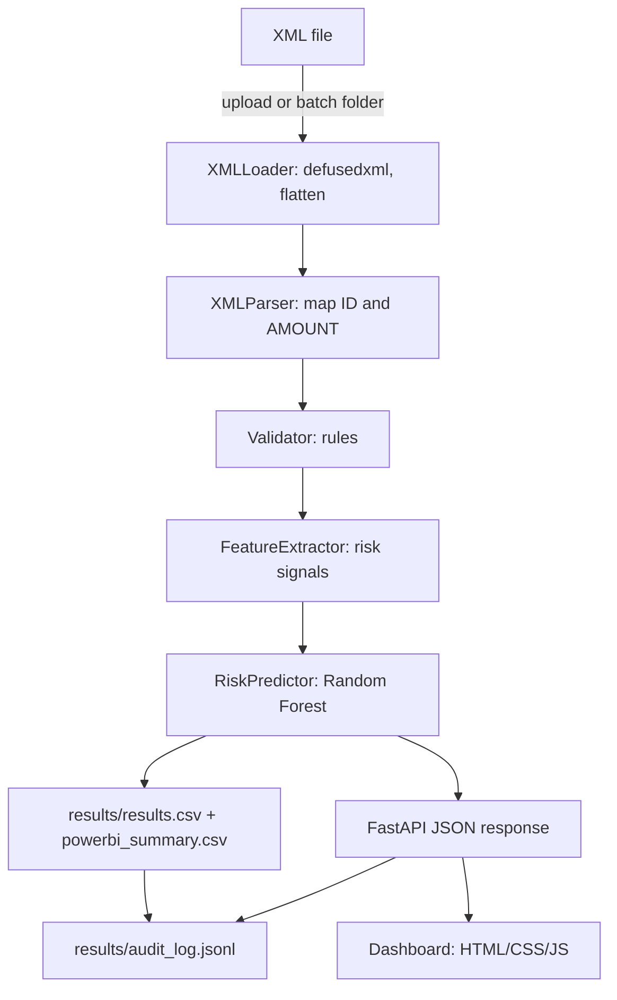

# SupplyTrace

Validate supplier XML invoices with deterministic rules, add an experimental risk score from a small Random Forest, and track every result on a web dashboard.

[](https://github.com/vishnuatgit/SupplyTrace/actions/workflows/ci.yml)

[](LICENSE)

## Live demo

**TODO: Render URL**

Pick one of the sample invoices (valid, sparse, missing ID, missing amount, bad amount, negative amount, high value), upload your own XML file (up to 1 MB), or edit XML in the sandbox. The demo runs on Render's free tier, which puts the service to sleep after 15 minutes without traffic, so the first request after a quiet spell can take up to a minute.

Everything in the demo is synthetic: the dashboard starts from a batch of 400 generated invoices and the risk model is trained on them. Please don't upload real invoices.

## What it does and why

Business systems exchange invoices as XML. A file that is missing its transaction ID or amount, or that carries a malformed amount, can pass through several hops before anything downstream fails, and by then it is hard to trace. SupplyTrace checks each file up front:

1. It flattens any nested XML (namespaces included) into dot-notation keys.
2. It finds the transaction ID and amount wherever they sit in the document.
3. It applies deterministic validation rules and labels the file `VALID`, `INVALID` or `REQUIRES_REVIEW`.
4. It extracts risk signals and, if a model has been trained, returns an **experimental** risk score from a Random Forest trained on synthetic data.
5. It writes every analysis to a JSON Lines audit log and shows results on a dashboard.

## Features

- **Nested XML flattening**: `Invoice.LegalMonetaryTotal.PayableAmount`-style keys, with default namespaces stripped per element so parent paths are kept.
- **Field mapping**: the ID is taken from `TransactionID`, `InvoiceID` or `DocumentID` first; a generic `ID` is used only near the top of the document, so a nested bank-account `ID` is never mistaken for the transaction ID. The amount comes from `PayableAmount`, `TotalAmount`, `InvoiceAmount`, `Amount` or `Total`.
- **Validation rules**: a missing ID, a missing amount, a non-numeric amount or a negative amount makes a file `INVALID`; an amount above 1,000,000 makes it `REQUIRES_REVIEW`.
- **Risk score (experimental)**: a scikit-learn `RandomForestClassifier` estimates the probability that a file fails straight-through processing; above 50% is flagged `HIGH`. See [ML model](#ml-model) for what it is and is not.
- **Batch pipeline**: processes a folder of XML files and writes `results/results.csv`, a one-row `results/powerbi_summary.csv` for BI tools, and the audit log.
- **Web dashboard**: one-click sample invoices, file upload and a sandbox editor; the submitted XML is shown next to the result, with the status, the reasons and the risk score. KPI cards, a valid-share gauge, the risk-flag split and the recent-analyses list combine the synthetic batch with the visitor's own analyses from the current browser session.
- **Audit log**: every analysis (batch and web) is appended to `results/audit_log.jsonl` with a UTC timestamp. Writing it is best effort (a read-only disk never fails a request), and it is rotated to `audit_log.jsonl.1` at about 1 MB.
- **Safe parsing of untrusted uploads**: XML is parsed in memory with `defusedxml` (DTDs, entity expansion and external entities are refused), documents nested more than 100 levels deep are rejected, and uploads over 1 MB get a `413` before the body is read.

## Architecture



The FastAPI app serves both the REST API and the static frontend from `frontend/`. On startup it trains the model from `results/results.csv`; if that file is missing or was written by an older version, it first generates the synthetic dataset and runs the batch pipeline, so a fresh clone or a fresh host works without any setup steps. Stats and history come from the last batch run; the browser adds the visitor's own analyses to them for the current session (kept in `sessionStorage`, not on the server).

## Tech stack

Python 3.11+, FastAPI, Uvicorn, pandas, scikit-learn, defusedxml, plain HTML/CSS/JavaScript, pytest, Ruff, GitHub Actions, Render.

## Quick start

```bash
git clone https://github.com/vishnuatgit/SupplyTrace.git
cd SupplyTrace
python -m venv .venv
# Windows: .venv\Scripts\activate    Linux/macOS: source .venv/bin/activate
pip install -r requirements.txt

python -m scripts.generate_data      # 400 synthetic invoices + outcomes.csv in data/raw_xml/ (fixed seed)
python -m scripts.run_pipeline       # validates them, trains the model, writes results/
python -m src.api.server             # http://127.0.0.1:8000
```

Then open http://127.0.0.1:8000 and click a sample, drag a file from `data/raw_xml/` onto the upload area, or use the **Sandbox Editor** tab. Interactive API docs are at http://127.0.0.1:8000/docs.

The two data steps are optional: if `results/results.csv` is missing, the server runs them itself on startup (it takes a few seconds). `generate_data` replaces any XML files already in `data/raw_xml/`.

## Configuration

All settings are optional environment variables. Relative paths are resolved against the working directory.

| Variable | Default | Purpose |
|:--|:--|:--|
| `SUPPLYTRACE_RESULTS_DIR` | `results` | Batch results (`results.csv`, `powerbi_summary.csv`). |
| `SUPPLYTRACE_DATA_DIR` | `data/raw_xml` | Where the startup bootstrap writes the synthetic invoices. |
| `SUPPLYTRACE_AUDIT_DIR` | same as results | Directory for `audit_log.jsonl`. |
| `SUPPLYTRACE_AUDIT_MAX_BYTES` | `1000000` | Size at which the audit log is rotated to `audit_log.jsonl.1`. |
| `SUPPLYTRACE_MAX_UPLOAD_BYTES` | `1000000` | Largest accepted upload. The frontend checks the same 1 MB limit before uploading. |
| `SUPPLYTRACE_BOOTSTRAP` | `1` | Set to `0` to skip generating the demo dataset on startup. |

The dev server (`python -m src.api.server`) listens on `127.0.0.1:8000` with auto-reload; in production run `uvicorn src.api.server:app --host 0.0.0.0 --port <port>`.

## Running tests

```bash
pip install -r requirements-dev.txt
python -m pytest          # unit + API tests, with coverage
ruff check . && ruff format --check .
```

The tests use FastAPI's `TestClient` and temporary directories; they need no network and never write to the repository's `data/` or `results/`.

## Project structure

```text
SupplyTrace/
├── frontend/            index.html, styles.css, app.js, favicon.svg (dashboard)
├── scripts/
│   ├── generate_data.py synthetic UBL-style invoices and outcomes (seeded)
│   └── run_pipeline.py  batch run over data/raw_xml/
├── src/
│   ├── api/             server.py (FastAPI app, static files), upload_limit.py,
│   │                    samples/ (the dashboard's one-click sample invoices)
│   ├── ingestion/       xml_loader.py (safe parse + flatten), parser.py (field mapping)
│   ├── validation/      rules.py
│   ├── features/        extractor.py (risk signals)
│   ├── prediction/      model.py (RiskPredictor)
│   ├── pipeline/        orchestrator.py (batch run), synthetic.py (data generator),
│   │                    bootstrap.py (startup data check)
│   ├── dashboard/       exporter.py (summary CSV)
│   └── utils/           audit.py (audit log writer with rotation)
├── tests/               pytest suite
├── docs/architecture.md
├── render.yaml          Render Blueprint for the live demo
├── requirements.txt     pinned runtime dependencies
└── requirements-dev.txt test and lint tools
```

## API reference

| Method | Path | Description |
|:--|:--|:--|
| `POST` | `/api/analyze` | Multipart upload (`file`, must end in `.xml`, up to 1 MB). Returns `filename`, `id`, `status`, `errors`, `features`, `prediction` (`risk_score`, `risk_flag`, or `"N/A"` without a model) and `processing_ms` (measured server time from parsing to prediction). `400` for a non-XML name, malformed XML, a DTD or too-deep nesting; `413` for a file over the size limit. |
| `GET` | `/api/stats` | Totals from the last batch run: processed, valid, invalid, review, failure rate, average risk, scored rows, high-risk flags. |
| `GET` | `/api/history` | The 15 most recent rows of `results/results.csv`, newest first. |
| `GET` | `/api/samples` | The sample invoices offered on the dashboard (`id`, `label`, `filename`). |
| `GET` | `/api/samples/{id}` | One sample invoice as XML. |
| `GET` | `/healthz` | Liveness check: `{"status": "ok"}`. |
| `GET` | `/` | The dashboard. |

## ML model

The risk score is **experimental and trained on synthetic data**. The validation status is the authoritative result; the score is there to show a small, honest ML component end to end, not to predict real supplier failures.

- **Data**: `src/pipeline/synthetic.py` writes 400 UBL-style invoices from a fixed seed. 65% are valid; 7% each are missing the transaction ID, missing the amount, have a non-numeric amount (`12,50.00`, `N/A`, ...), have a negative amount, or exceed 1,000,000. Independently, 40% are "sparse" (each optional field - issue date, currency, supplier, payment account - is dropped with probability 1/2) and 20% are wrapped in a three-level transport envelope.
- **Label** (`failed`, written to `data/raw_xml/outcomes.csv`): a simulated downstream outcome that follows documented rules. A file that breaks a validation rule or needs review always fails. Any other file fails with probability 2% + 4% per missing optional field + 3% if the amount is 100,000 or more + 3% if it is wrapped, capped at 20%.
- **Features** (`src/features/extractor.py`): missing ID, missing amount, non-numeric amount, negative amount, amount above the review limit, amount of 100,000 or more, number of missing optional fields (0-4) and nesting depth. File size is shown but deliberately not used, and nothing is simulated: the earlier `processing_time` and `retry_attempts` features are gone.
- **Training**: `RandomForestClassifier(n_estimators=100, max_features=None, min_samples_leaf=10, random_state=42)`. With only eight features every split considers all of them, so each rule-breaking group gets its own leaves, and the leaf size smooths the noisy outcomes of otherwise-valid files. `python -m scripts.run_pipeline` fits it on the batch and scores the same batch; the API server re-fits it at startup from `results/results.csv`. No model file is saved; with the fixed seeds the result is the same every run.
- **Behaviour**: rule-breaking files score close to 100% (`HIGH`); valid files score low, rising with each missing optional field (about 2% for a complete invoice, about 18% for the sparse sample). The tests check that across every combination of signals the band never contradicts the validation status, and the data and model settings were chosen after checking the same property on ten different seeds.
- **Evaluation**: no accuracy figure is reported. Because the labels come from the same rules and signals the model sees, any score on held-out synthetic data would only show that the model recovers the simulation, not that it predicts real outcomes.

## Deploy on Render

The repository includes a [Render Blueprint](render.yaml) for a free web service:

1. Push the repository to GitHub.
2. In the Render dashboard choose **New > Blueprint**, select the repository and apply `render.yaml`.
3. When the deploy finishes, open the service URL and replace the `TODO` under [Live demo](#live-demo).

The Blueprint uses these settings, which can also be entered by hand for a plain web service:

| Setting | Value |
|:--|:--|
| Runtime | Python, `PYTHON_VERSION=3.11.9` |
| Plan / region | Free / Singapore |
| Build command | `pip install -r requirements.txt && python -m scripts.generate_data && python -m scripts.run_pipeline` |
| Start command | `uvicorn src.api.server:app --host 0.0.0.0 --port $PORT` |
| Health check path | `/healthz` |

Render's free disk is ephemeral: the synthetic batch is generated during the build, the server regenerates it on startup if it is missing, and the audit log is reset on every restart or redeploy.

## Limitations and roadmap

- The risk model is trained on synthetic data with simulated outcomes; real use needs outcome data from the downstream system.
- Dashboard totals combine the last batch run with the current visitor's session; analyses are not shared between visitors or kept after the tab is closed.
- Repeated sibling elements (for example several invoice lines) collapse to the last one when flattened; XML attributes are ignored.
- Planned: a persistent store for uploads, a saved and versioned model artifact, and outcome data that does not come from the validation rules.

## License

[MIT](LICENSE) © 2026 Chandana Vishnu Jayanth
