# SupplyTrace process flows

Every journey a visitor can take through the web app, and every flow the backend runs, with the files and functions involved and what happens when something goes wrong. Diagrams are Mermaid, which GitHub renders.

- [User flows](#user-flows)
  1. [First visit: the dashboard loads](#1-first-visit-the-dashboard-loads)
  2. [Check a sample invoice](#2-check-a-sample-invoice)
  3. [Check your own file](#3-check-your-own-file)
  4. [Edit XML in the sandbox](#4-edit-xml-in-the-sandbox)
  5. [Read a result](#5-read-a-result)
  6. [Run a batch](#6-run-a-batch)
  7. [Browse the audit log](#7-browse-the-audit-log)
  8. [Read the rules and the model card](#8-read-the-rules-and-the-model-card)
  9. [Navigate, deep-link and switch theme](#9-navigate-deep-link-and-switch-theme)
- [System flows](#system-flows)
  1. [Server startup](#s1-server-startup)
  2. [One analysis request](#s2-one-analysis-request)
  3. [Validation: the rule checklist](#s3-validation-the-rule-checklist)
  4. [Risk score and its explanation](#s4-risk-score-and-its-explanation)
  5. [Batch requests, one-shot and streamed](#s5-batch-requests-one-shot-and-streamed)
  6. [Audit log: write, rotate, read](#s6-audit-log-write-rotate-read)
  7. [Dashboard overview](#s7-dashboard-overview)
  8. [Batch pipeline from the command line](#s8-batch-pipeline-from-the-command-line)
  9. [Serving the frontend](#s9-serving-the-frontend)
- [Error reference](#error-reference)

The frontend is plain HTML, CSS and JavaScript modules in `frontend/` (no build step). The API is FastAPI in `src/api/`. Paths below are relative to the repository root.

---

## User flows

### 1. First visit: the dashboard loads

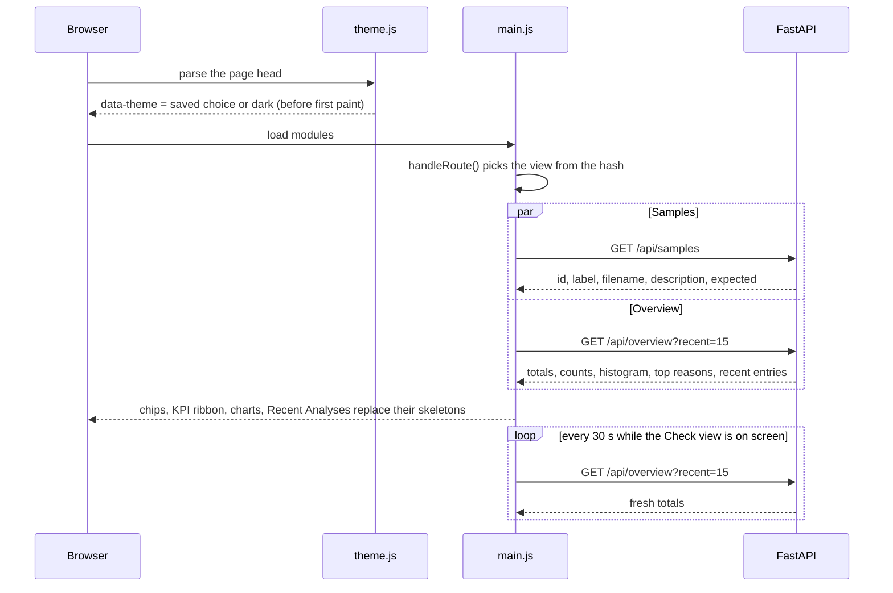

**Steps**

1. `frontend/js/theme.js` runs synchronously in `<head>` and sets `data-theme` from `localStorage` (`supplytrace.theme`), defaulting to dark, so the page never flashes the wrong theme.
2. `main.js` wires every view (`initCheck`, `initBatch`, `initAudit`, `initOverview`, `initPipeline`, `initChartTooltips`) and calls `handleRoute()`. `initPipeline()` also builds the compact pipeline strip inside the inspector's loading placeholder.
3. The Check view's `onShow` is `refreshOverview()` (`overview.js`), which fetches `/api/overview` and renders the KPI ribbon (with a short count-up), the Valid share ring (with the number of files it covers), the risk histogram, the most common reasons and the Recent Analyses accordion. The histogram is drawn at its container's real width, so its labels are never scaled down, and is redrawn when that width changes; it has ticks at 0, 25, 50, 75 and 100%, the dashed 50% threshold, a Low/High proportion bar and a legend with both counts.
4. Each Recent Analyses row keeps the same height: the file name on the first line; the transaction ID (cut short with an ellipsis when space runs out, in full on hover), the source and the relative time on the second. Rows this browser tab checked are tagged **You**: after a check, `rememberChecks()` keeps the `logged_at` timestamp the server returned (in `sessionStorage`), and the feed matches it against each entry's `timestamp` and file name.
5. The overview refreshes after every check, when the browser tab becomes visible again, and every 30 seconds while the Check view is on screen (`scheduleRefresh()`). The tag in the panel header reads "Live · audit log".
6. `check.js` `loadSamples()` fetches `/api/samples` and renders one chip per sample, each with a dot in the colour of the status it is built to get. Hovering or focusing a chip shows its description in the hint line.

**Loading and empty states.** Skeleton blocks hold the place of the KPI values, chips, charts and feed, so nothing jumps when data arrives. An empty audit log shows "No analyses yet" with a Try a sample link; a histogram with no scored files says so.

**Errors.** If the first `/api/overview` request fails, the caption says why, each chart and the feed show a Retry button, and the tag reads "Not loaded" with a grey dot. If a later refresh fails, the numbers on screen stay: the tag turns grey and says when they were loaded ("Updated 2 minutes ago"), and the caption says "Couldn't refresh the totals (offline?). Showing the ones loaded 2 minutes ago." with a Retry button. If `/api/samples` fails, the chip row shows the reason and a Retry button. Messages come from `api.js` `request()`, which turns network failures and non-JSON error pages (for example a proxy page while a sleeping host wakes up) into plain sentences.

### 2. Check a sample invoice

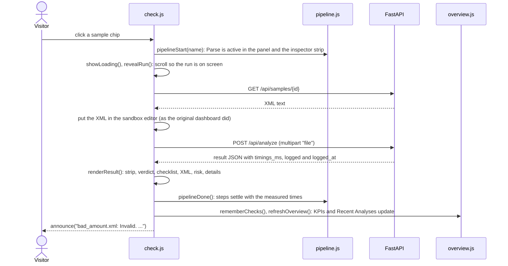

**Steps**

1. `runSample()` marks the chip as pressed, disables the inputs (one check at a time) and calls `pipelineStart()`. One run drives two views of the pipeline (`pipeline.js`): the How it works panel at the top of the page and a compact strip (`pipelineStrip()`) inside the Payload Inspector, so the run is visible wherever the visitor is looking. Parse shows a spinner while the file travels (the strip says "running", and "waiting" for the steps after it).
2. `showLoading()` replaces the input pane with a placeholder that starts with the strip and calls `revealRun()`: when the placeholder is not already comfortably on screen (between 70 px from the top and 60% of the viewport), the page scrolls so the inspector's header and chips sit at the top with the strip right under them, or, when the header and chips are too tall for that, so the strip sits near the top.
3. The sample's XML is fetched, loaded into the sandbox editor with its file name, and sent as a `File` by `check()`, which waits at least 300 ms so the start of the run is visible even on a fast server.
4. On success, `renderResult()` draws the result in place of the placeholder (see flow 5), starting with a live strip in the same position, so nothing jumps. `pipelineDone()` then settles Parse, Validate, Score and Log one after another (150 ms apart, at once under reduced motion) in the panel and the strip together, each with the time the server measured for that stage (`timings_ms`): for example "Parse 0.3 ms, Validate 0.5 ms, Score 17 ms, Log written". Validate includes locating the lines; Log says "written" or, if the audit write failed, "not written". The panel's status line ends as "Invalid · 4.1 ms on the server".
5. The URL becomes `#/check?sample=<id>`, so the check can be shared or reloaded.
6. `rememberChecks()` and `refreshOverview()` run; the new entry appears at the top of Recent Analyses with a short highlight and the You tag.

**Errors.** If the sample or the check request fails, `pipelineFail()` marks Parse as failed with a short label (offline, server error, too large, line 3) and the other steps as skipped, in the panel and the strip. The inspector shows a Not checked card (`renderError()` in `result.js`) whose tone says whose problem it is. A network failure is amber: "NOT REACHED · Couldn't reach the server". A 5xx is amber too: "NOT CHECKED · The server couldn't finish the check". Both offer Try again. A refused file (4xx) is red ("File could not be read", "File is too large") and has no Try again, because retrying the same file cannot help. Check another is always there.

### 3. Check your own file

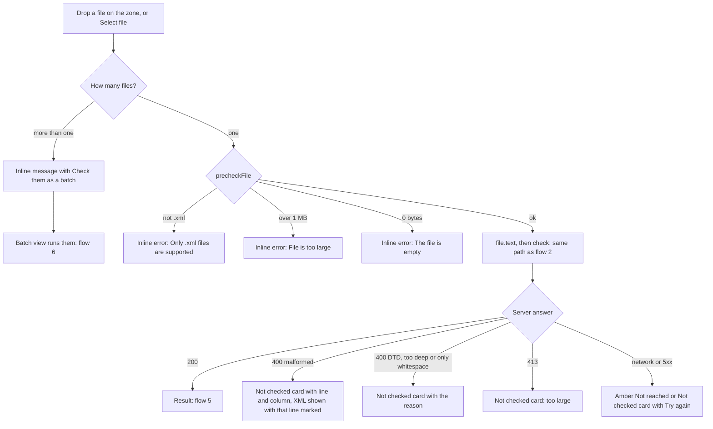

**Steps**

1. `setupDropzone()` (`ui.js`) handles drag and drop on the zone; a click anywhere on it, or the Select file button, opens the file picker.
2. `handleFiles()` (`check.js`) sends more than one file to the batch view (with a button, so it is the visitor's choice), and runs `precheckFile()` (`api.js`): the `.xml`, 1 MB and empty-file checks the server makes, so obvious problems are caught without an upload.
3. A file that passes is read with `file.text()` (so the page can show it) and checked by `check()`, exactly as in flow 2. The URL becomes `#/check`.

**Errors.** For malformed XML the server's 400 body carries `line`, `column` and `reason` (for example "mismatched tag"). The Not checked card shows "Line 3, column 22: mismatched tag", the pipeline marks Parse as failed at "line 3", and the XML is shown with the breaking line marked. Fix in sandbox opens the file in the editor at that line (flow 4). A DTD, an entity declaration, nesting deeper than 100 levels, or a file with nothing but whitespace gets the server's message. Files over 1 MB that slip past the browser check are refused by the server with a 413 before the body is read.

### 4. Edit XML in the sandbox

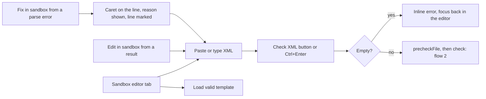

**Steps**

1. The tabs follow the WAI-ARIA tabs pattern (`setupTabs()` in `ui.js`: click or arrow keys). Selecting a tab returns the inspector from a result to the input panes.
2. The editor has a line-number gutter that follows the text and its scroll (`updateGutter()` in `check.js`). Typing renames the file to `sandbox_invoice.xml`, because edited content is the visitor's own file.
3. Load valid template fetches `/api/samples/valid` into the editor and confirms with a toast.
4. `editInSandbox(text, name, problem)` is used by Edit in sandbox (result toolbar), Fix in sandbox (error card) and the batch drawer. It opens the editor with the text. With a `problem` (`{ line, column, reason }` from a parse error) it puts the caret at the start of that line, scrolls it into view, shows the parser's reason above the editor ("Line 3, column 22: mismatched tag. The caret is on that line; fix it and check again."), marks the line number in the gutter and lays a red band across the line behind the text (`showEditorProblem()`, `placeBand()`, which follows the editor's scroll). The note and the marks go away at the first edit.
5. Check XML (or Ctrl+Enter / Cmd+Enter) runs `checkSandbox()`.

**Errors.** An empty editor gives an inline message and puts the focus back in the editor. Everything after that is the same as flow 3.

### 5. Read a result

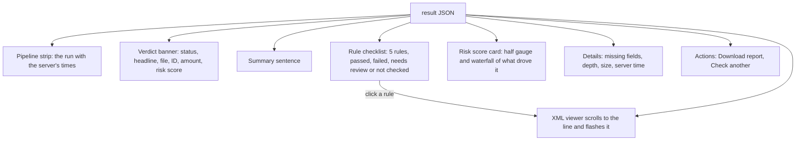

**Steps** (`renderResult()` in `frontend/js/result.js`)

1. **Pipeline strip** at the top: in the inspector it is the live strip that settles as the run finishes (flow 2); in the batch drawer it shows that file's run, already settled.
2. **Verdict**: the status in its colour with an icon (never colour alone), a headline such as "1 rule failed", the file name, the transaction ID and amount as found, and the risk score with an Experimental tag.
3. **Rule checklist** from the `checks` array the server returns: every rule in order, with its state and a note such as `<PayableAmount> on line 47 holds "12,50.00"`. Rules that could not be reached say why ("Not checked: the amount is not a number") in a dashed row whose text keeps AA contrast. Each rule with a line is a button; clicking it marks the rule (`aria-current`) and calls `revealLine()` (`xml-view.js`), which scrolls the XML viewer to that line, brings the viewer into view and flashes the line, and announces it to screen readers. The focus stays on the rule, so a keyboard user can move straight to the next one. Hovering a failed or review rule (on devices with a pointer) strengthens its own red or amber; a tap on a phone does not leave it grey. The same line numbers are badges in the viewer's gutter.
4. **XML viewer** (`renderXml()`): syntax colours, line numbers in a sticky gutter, and marks for failed rules (red), review (amber) and where the ID and amount were found (indigo), with a legend. It opens scrolled to the first problem. Copy puts the XML on the clipboard (with a fallback when the Clipboard API is unavailable); Edit in sandbox opens it in the editor. Files over 4,000 lines are cut off in the preview, with a note.
5. **Risk score**: a half gauge with the 50% threshold marked, and a waterfall (`riskWaterfall()` in `charts.js`) from the training base rate through the four biggest feature contributions (the rest combined) to the score. Values are in percentage points ("+59.9 pts", "−2.5 pts"), explained in a caption. Each bar starts where the previous one ended, and the axis widens to fit every running total: a big push up can pass 100% before smaller pushes down bring it back, and those are drawn at their true size instead of being clipped. Ticks mark 0%, 50% and 100%. On phones each row puts the label and value on one line and the bar full width under them. A note says the model is trained on 400 synthetic invoices and that the status is the decision. Without a trained model the card says the score is not available.
6. **Details**: the original dashboard's metrics (missing required, missing optional out of 4, nesting depth, file size, server time with a per-stage breakdown on hover).
7. **Actions**: Download report saves the result as JSON with a timestamp and an honesty note; Check another resets the pipeline and returns to the input pane.

### 6. Run a batch

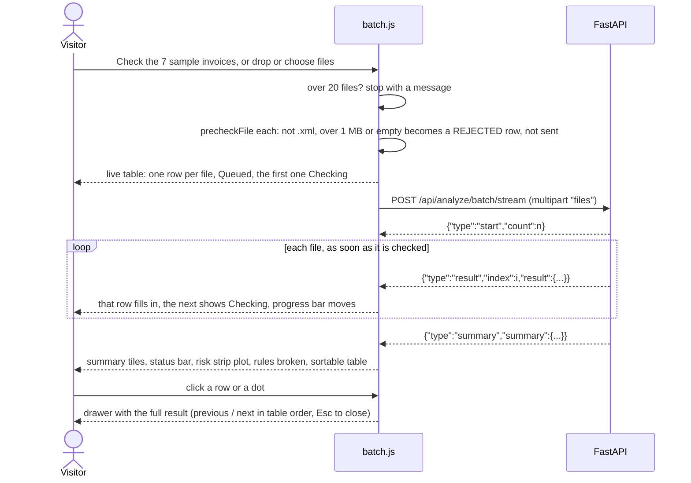

**Steps**

1. The sample button's label and hint come from `/api/samples` (`describeSamples()`): "Check the 7 sample invoices", "2 valid, 4 invalid and 1 that needs review, all synthetic."
2. `runSamples()` shows "Fetching the sample invoices…" with skeleton rows, fetches every sample's XML and builds `File`s; `runFiles()` takes dropped or chosen files (a multi-file drop on the Check view leads here too).
3. `check()` refuses more than 20 files with a message and turns files the server would refuse anyway (not `.xml`, over 1 MB, empty) into REJECTED rows without uploading them. `showLive()` then shows the table at once: refused files are final, every other file is "Queued" and the first is "Checking". The rest are posted with `postFilesStream()` (`api.js`), which reads the NDJSON response line by line. Each `result` line replaces its row with the real one (a short fade-in, none under reduced motion) and marks the next file as Checking (`liveResult()`); the progress panel shows "Checked bad_amount.xml" and "3 / 7".
4. When the summary line arrives, `render()` shows: Files and per-status tiles with shares, a stacked status bar, a strip plot of every file's risk score on a 0 to 100% axis with the 50% threshold (drawn at its container's width and redrawn on resize; dots are focusable and open the drawer), a bar list of the rules broken in this batch, and the table. `rememberChecks()` records the files so they show as You on the dashboard.
5. The table (`renderTable()`) sorts by any column (header buttons with `aria-sort`), shows a coloured edge for files that need attention, and opens any file in the drawer.
6. `openDrawer()` renders the same result view as flow 5 inside a modal `<dialog>`, with a pipeline strip of that file's server times (focus is trapped and returned; Esc and a backdrop click close it). Previous and next (or Alt+arrow keys) follow the table as it is sorted on screen (`stepDrawer()`), and the eyebrow says so: "File 2 of 7 · sorted by status". Rejected files show the reason and, for malformed XML, the breaking line with Fix in sandbox.
7. CSV and JSON downloads (`downloadCsv()`, `downloadJson()`). CSV cells that start like a spreadsheet formula (`=`, `+`, `-`, `@`) are prefixed with `'`, and a byte-order mark makes Excel read UTF-8.

**Errors.** A network failure, a 5xx or a connection that drops mid-stream ("The connection dropped before the batch finished") gives an amber "The batch did not finish" card with Try again, which repeats the same action: the same samples, or the same files (`guarded()` keeps the retry). More than 20 files, or a request body over 20 MB (413), gives a red "The batch could not be checked" card. When the failed batch was the visitor's own files, both cards also offer Check the samples instead. A file the server cannot read is a REJECTED row with its reason instead of failing the batch.

### 7. Browse the audit log

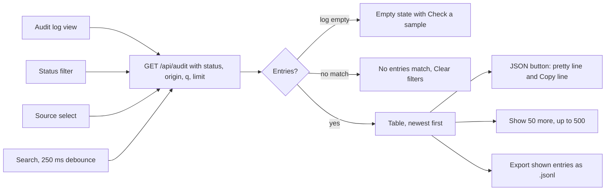

**Steps** (`frontend/js/audit.js`)

1. `showAudit()` runs `load()` each time the view opens. Only the latest request may render (a request counter), so quick filter changes never show stale results.
2. The status filter is a radio group styled as segments, with counts that follow the source and search filters (the server computes them). The source select chooses single checks, batch checks or the startup batch; the search matches file names and transaction IDs.
3. A thin stacked bar shows the status split of what the filters match.
4. Each row shows the time (absolute and relative), file with its source and size, transaction ID, status, risk and reasons. The JSON button opens the exact line from the log, pretty-printed, with Copy line.
5. Show more raises the limit by 50, up to the API's 500. Export saves the shown lines as JSON Lines. Refresh reloads and confirms with a toast.
6. On phones the table becomes stacked cards: a label column on the left and every value beside it, at its natural width (badges do not stretch, file names wrap only when they must), and the JSON block scrolls inside the card.

**Errors.** A failed load shows an error card with Try again.

### 8. Read the rules and the model card

`showReference()` (`frontend/js/reference.js`) fetches `/api/rules` and `/api/model` once and renders:

- the five rules as cards: number, title, outcome badge, plain-language summary, the message written to the log, and a syntax-coloured example document that breaks the rule (the test suite runs each example through the real pipeline);
- as a sixth card in the same grid, where the ID and the amount are looked for (tag names come from `src/ingestion/parser.py`);
- the model card: an experimental notice, what it predicts, the model and its settings, the training data and how labels are simulated, how explanations work, feature importances as bars, the holdout metrics against a rules-only baseline with both confusion matrices, a plain reading of what those numbers do and do not show, and the limitations.

**Errors.** A failed load shows an error card with Try again. With no trained model the card says so and skips the metrics.

### 9. Navigate, deep-link and switch theme

- `main.js` is a hash router over five views: `#/check`, `#/batch`, `#/audit`, `#/rules`, `#/about`. Changing view sets the title, marks the nav link with `aria-current`, scrolls to the top and moves focus to the view's heading.
- Deep links: `#/check?sample=<id>` runs that sample; `#/batch?run=samples` runs the sample batch once.
- The theme button switches dark and light, saves the choice in `localStorage` (wrapped in try/catch, so blocked storage only means the choice is not remembered) and updates the `theme-color` meta tag.
- On phones the header keeps every link: the brand with "Built by Vishnu Jayanth" as a byline under it, the theme and GitHub buttons, and all five tabs in one row down to 360 px. On the Check view the first screen holds the one-line description, the compact How it works row and the first sample chips.
- Motion is short (mostly 150 to 450 ms; a jumped-to line and a new feed entry fade their highlight over about a second) and is turned off under `prefers-reduced-motion`; the pipeline then settles at once.

---

## System flows

### S1. Server startup

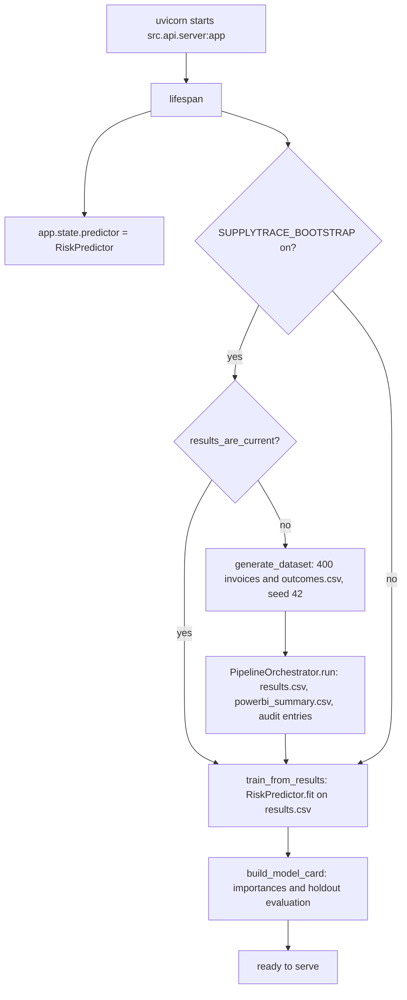

**Files and functions:** `src/api/server.py` `lifespan()`, `train_from_results()`; `src/pipeline/bootstrap.py` `ensure_demo_results()`, `results_are_current()`; `src/pipeline/synthetic.py` `generate_dataset()`; `src/pipeline/orchestrator.py` `PipelineOrchestrator.run()`; `src/prediction/model.py` `RiskPredictor.fit()`; `src/prediction/model_card.py` `build_model_card()`, `holdout_evaluation()`.

**Failure handling:** bootstrapping is best effort (a read-only disk logs an error and the server still starts). If `results.csv` is missing or unreadable the model stays untrained: checks still work and report the risk score as `N/A`, the model card says it is not trained, and the page says the score is not available. The holdout evaluation is skipped (returns `None`) if the data cannot support it.

### S2. One analysis request

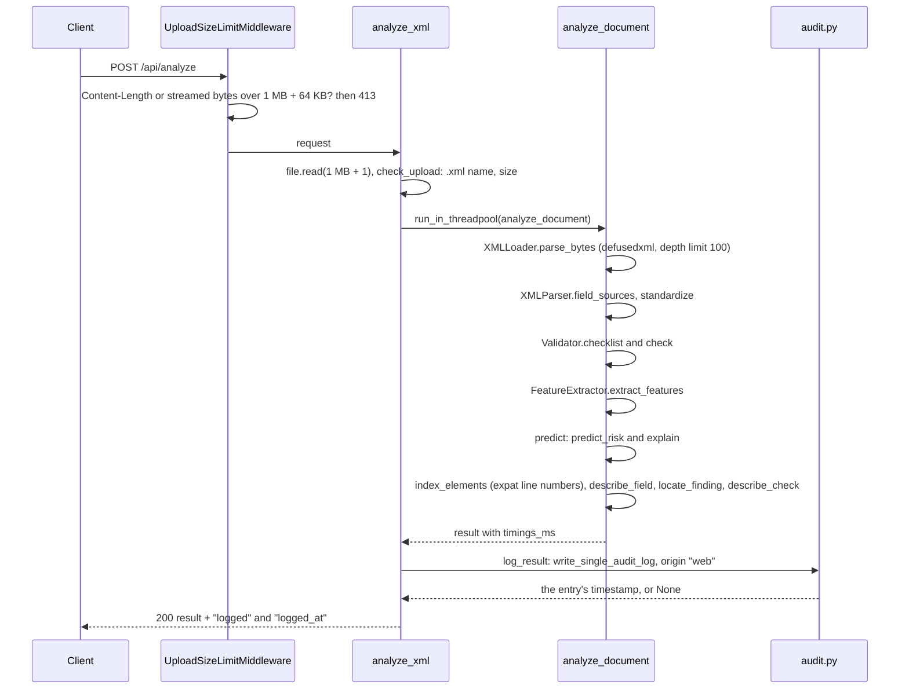

**Files and functions:** `src/api/upload_limit.py` `UploadSizeLimitMiddleware`; `src/api/server.py` `analyze_xml()`, `log_result()`, `write_single_audit_log()`; `src/api/analysis.py` `check_upload()`, `analyze_document()`, `predict()`, `describe_field()`, `locate_finding()`, `describe_check()`; `src/ingestion/xml_loader.py` `XMLLoader.parse_bytes()`; `src/ingestion/parser.py` `XMLParser`; `src/ingestion/locator.py` `index_elements()`; `src/validation/rules.py` `Validator`; `src/features/extractor.py` `FeatureExtractor`; `src/prediction/model.py` `RiskPredictor`.

**Output:** `filename`, `id`, `status`, `errors`, `findings` (broken rules with lines), `checks` (all five rules with state and line), `fields` (where the ID and amount came from), `features`, `prediction` (`risk_score`, `risk_flag`), `risk_drivers` (`base` and per-feature `contributions` in percentage points, or `null`), `processing_ms`, `timings_ms` (`parse`, `validate`, `score`, `locate`), `logged`, and `logged_at` (the timestamp of the audit entry, or `null` when it could not be written; the page uses it to tag the visitor's own checks).

**Failure handling:**

| Situation | Where | Response |
|:--|:--|:--|
| Body over the limit | middleware, or `check_upload` | `413` "File is too large. The demo accepts XML files up to 1 MB." |
| File name not `.xml` | `check_upload` | `400` "Only .xml files are supported" |
| Empty, or only whitespace | `XMLLoader.parse_bytes` | `400` "The file is empty" |
| Malformed XML | `XMLLoader.parse_bytes` | `400` "Invalid or malformed XML file" plus `line`, `column`, `reason` |
| DTD or entity declaration | `XMLLoader.parse_bytes` | `400` "DTDs and entity declarations are not allowed" |
| Nesting deeper than 100 | `XMLLoader._flatten_tree` | `400` "XML nesting is too deep (limit is 100 levels)" |
| Unexpected failure after parsing | `analyze_document` | `500` "Analysis failed" (logged on the server) |
| Model untrained or prediction fails | `predict` | `200` with `risk_score` "N/A" and `risk_drivers` null |
| Audit log cannot be written | `append_audit_entries` | `200` with `logged: false` and `logged_at: null` |

The upload is parsed in memory and never written to disk. The parse and scoring run in a thread pool so they do not block the event loop.

### S3. Validation: the rule checklist

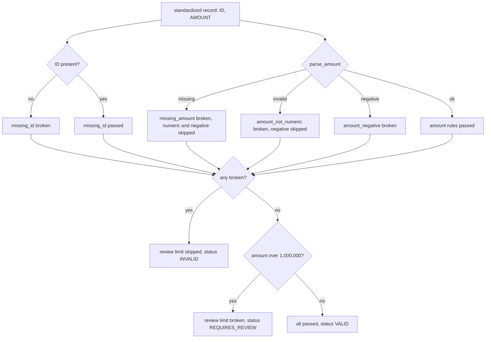

`Validator.checklist()` (`src/validation/rules.py`) is the single source of truth: it returns every rule with `passed`, `broken` or `skipped`, and `Validator.check()` derives the status and the broken rules from it, so the checklist on the page can never disagree with the status. Each rule is defined once as a `Rule` (code, title, field, outcome, message, summary, example) and served by `GET /api/rules`. `describe_check()` (`src/api/analysis.py`) adds the line and a note for each rule: the finding's line for a broken rule, the field's line for a passed one, and the reason a rule was skipped.

How the ID and amount are found (`src/ingestion/parser.py`): the first non-empty `TransactionID`, `InvoiceID` or `DocumentID`, or a plain `ID` within 3 levels of the root; the first non-empty `PayableAmount`, `TotalAmount`, `InvoiceAmount`, `Amount` or `Total`. `index_elements()` (`src/ingestion/locator.py`) makes a second pass with Python's expat parser to record the start and end line of every element, because ElementTree does not keep line numbers; it refuses a DOCTYPE itself and returns an empty index if the document cannot be read, so line numbers are only ever a display aid.

### S4. Risk score and its explanation

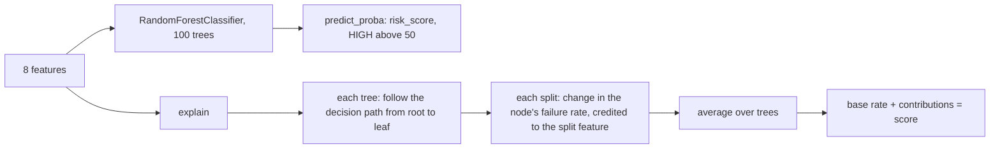

`RiskPredictor.predict_risk()` returns the probability of the "failed" class as a percentage, flagged `HIGH` above 50. `RiskPredictor.explain()` (`src/prediction/model.py`) splits that score into the base rate (the failure rate at the root of each tree, averaged) plus one contribution per feature: along each tree's path from the root to the file's leaf, every split changes the estimated failure rate, and that change is credited to the feature the split tested. Averaged over the forest, base plus contributions equals the score (a test checks this to within 0.1 points). `predict()` in `src/api/analysis.py` adds a short label to each contribution from `FEATURE_LABELS` (`src/features/extractor.py`).

The model is experimental: it is trained at startup on the 400 synthetic invoices, with labels simulated from documented rules in `src/pipeline/synthetic.py`. The status always comes from the rules.

### S5. Batch requests, one-shot and streamed

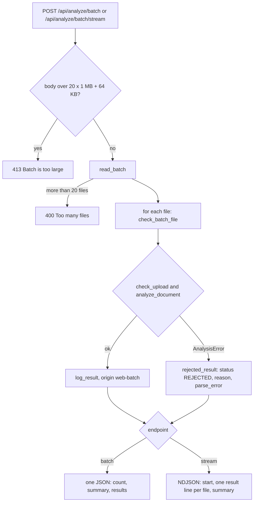

Both endpoints share `read_batch()`, `check_batch_file()` and `summarize()` in `src/api/server.py`, and both run each file through `analyze_document()`, so a file gets the same answer in a single check, a batch or a stream (tests compare all three). The streamed endpoint reads every upload first, then yields one line per file as soon as it is checked, so the page shows real progress. Accepted files carry `logged` and `logged_at` like a single check. Rejected files are not written to the audit log, the same as a rejected single upload.

### S6. Audit log: write, rotate, read

- **Write** (`append_audit_entries()` in `src/utils/audit.py`): creates the directory, rotates `audit_log.jsonl` to `audit_log.jsonl.1` once it reaches `SUPPLYTRACE_AUDIT_MAX_BYTES` (1 MB by default, about 4,000 entries), and appends one JSON object per line. It is best effort: any failure is logged and reported by returning `False`, never raised. For the API, `write_single_audit_log()` (`src/api/server.py`) builds the entry and returns its timestamp (or `None`), and `log_result()` puts that on the result as `logged` and `logged_at`.
- **Entry**: `timestamp` (UTC), `source_file`, `transaction_id`, `validation_status`, `errors`, `risk_score`, `risk_flag`, `origin` (`web`, `web-batch` or `pipeline`), and, for the dashboard, `xml_size`, `nesting_depth`, `missing_optional_fields` and (for web checks) `processing_ms`.
- **Read** (`read_audit_entries()`): newest first, each entry with its exact line; blank, broken or non-object lines are skipped, and a missing log reads as empty.
- **API** (`get_audit()` in `src/api/server.py`): filters by `status`, `origin` and `q` (case-insensitive search in the file name and transaction ID, up to 200 characters), returns `total`, per-status `counts` after the origin and search filters, `matching`, and up to `limit` (1 to 500) entries. Invalid parameters get a `422`.

### S7. Dashboard overview

`GET /api/overview` reads the audit log and `build_overview()` (`src/dashboard/overview.py`) returns: `total`; `counts` per status; `origins`; `valid_share` and `invalid_rate` (percent, or `null` for an empty log); `scored`, `average_risk`, `high_risk` and `low_risk`; a 10-bin `risk_histogram`, each bin split into LOW and HIGH flags; the five most common `top_reasons` with their status; `latest`; and the newest `recent` entries (1 to 50, default 15). Values that are not valid statuses, origins or numbers are ignored rather than counted. The page calls it on load, after every check, whenever the Check view is shown again or the browser tab becomes visible, and every 30 seconds while the Check view is on screen; a failed refresh keeps the last numbers on screen, marked with when they were loaded.

### S8. Batch pipeline from the command line

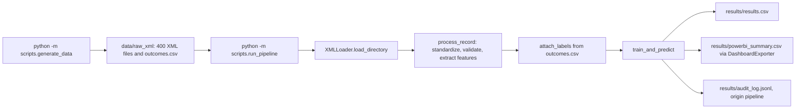

`PipelineOrchestrator` (`src/pipeline/orchestrator.py`) runs the same parser, rules and features as the API over a folder. Files that cannot be parsed are logged and skipped. Files without a recorded outcome count as failed unless their status is VALID. If the data has only one class the model stays untrained and the scores are `N/A`. `GET /api/stats` and `GET /api/history` serve the summary and the last 15 rows of this run, for BI tools.

### S9. Serving the frontend

`FrontendFiles` (`src/api/server.py`) serves `frontend/` from the same origin as the API, so no CORS headers are needed. Every static response has `Cache-Control: no-cache` (browsers revalidate with a cheap 304, so a deploy never runs against a stale script), a strict `Content-Security-Policy` (scripts and connections only from the same origin, styles from the same origin and Google Fonts, fonts from Google Fonts, no framing), `X-Content-Type-Options: nosniff` and a `Referrer-Policy`. The interactive API docs at `/docs` are served by FastAPI itself and are not affected.

---

## Error reference

| What the visitor sees | Cause | Code path |
|:--|:--|:--|
| "file.txt: Only .xml files are supported." (inline) | Wrong extension, caught in the browser | `precheckFile()` in `api.js` |
| "empty.xml: The file is empty." (inline) | A 0-byte file, caught in the browser (the server says the same for a file of only whitespace) | `precheckFile()`, `XMLLoader.parse_bytes()` |
| "big.xml: File is too large. The demo accepts XML files up to 1 MB." (inline) | Over 1 MB, caught in the browser | `precheckFile()` |
| "That's 3 files. Check them as a batch" | Several files dropped on the single-file zone | `handleFiles()` in `check.js` |
| "The sandbox editor is empty. ..." | Check XML with nothing in the editor | `checkSandbox()` |
| Not checked: "Invalid or malformed XML file. Line 3, column 22: mismatched tag." with the line marked; Fix in sandbox keeps the reason and marks the line in the editor | Malformed XML | `XMLLoader.parse_bytes()`, `renderError()`, `editInSandbox()` |
| Not checked: "DTDs and entity declarations are not allowed" | DOCTYPE in the upload | `XMLLoader.parse_bytes()` |
| Not checked: "XML nesting is too deep (limit is 100 levels)" | Deeply nested document | `XMLLoader._flatten_tree()` |
| Amber "Not reached: Couldn't reach the server" with Try again | Network failure or a sleeping host | `request()` in `api.js`, `errorBanner()` in `result.js` |
| Amber "Not checked: The server couldn't finish the check" ("The server is starting up or busy. ...") with Try again | 502, 503 or 504 from the host | `messageForStatus()` in `api.js` |
| Amber "The batch did not finish" with Try again (same samples or same files) | Network failure, 5xx or a dropped stream during a batch | `guarded()` and `showError()` in `batch.js` |
| Grey dot, "Updated 2 minutes ago", "Couldn't refresh the totals (offline?)" with Retry | A dashboard refresh failed after an earlier one worked | `renderStale()` in `overview.js` |
| "That's 25 files. A batch can hold up to 20; ..." | Too many files for a batch | `check()` in `batch.js` (and `read_batch()` on the server) |
| REJECTED row with its reason | A batch file the server or the browser refused | `rejected_result()`, `rejectedRow()` |
| "The check worked, but the server could not write it to the audit log." | Audit write failed | `write_single_audit_log()` returned `False` |
| "Risk score: Not available" | No trained model on the server | `predict()` in `analysis.py` |
