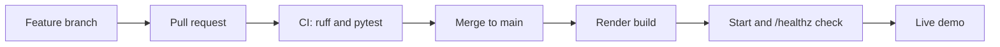

# Software development lifecycle: SupplyTrace

SupplyTrace checks supplier XML invoices with deterministic rules, points each rule at a line of the file, adds an experimental Random Forest risk score, and logs every result to an audit log shown on a web dashboard ([README](../README.md)). It is a solo student project by Chandana Vishnu Jayanth. Work was iterative. Early commits went straight to `main`. From 2026-11-02 changes went through short-lived branches merged by pull request. The first commit is dated 2026-06-11 and the latest 2026-11-09. The repo has 57 commits on `main` (`git rev-list --count HEAD`), 11 merge commits for pull requests #3 to #14 (no #2, #10), and one squash-merged pull request (#1, "Fix parsing and API bugs, add tests, CI, license and accurate README").

## 1. Planning and requirements

- **Problem.** Bad invoice data fails far downstream, where it is hard to trace. SupplyTrace checks each file on arrival ([README](../README.md), intro).
- **Users and scope.** A demo for reviewers and visitors, not a multi-user service. Functional scope is in the README "What it does" and "Features": safe parsing, five validation rules, risk score, batch check (up to 20 files of 1 MB), audit log, review queue, duplicate detection, vendor directory.
- **Non-functional requirements as stated.** Safe XML parsing (no DTDs, depth limit 100, 1 MB upload limit), the same result for single, batch and streamed checks, no network needed for tests, keyboard access and no horizontal scroll down to 360 px ([README](../README.md)).
- **Out of scope.** The README "Limitations" lists: model trained on synthetic data only, five rules only, no accounts or authentication, no saved model. [roadmap.md](roadmap.md) records nine wishlist items: three built (review workflow, duplicate detection, vendor directory), the rest declined or deferred with reasons (Celery/Redis, OCR, invoice version history).

## 2. Design

- **Architecture.** One FastAPI app serves the API and a static frontend. Each file passes through parse, validate, features, score and audit-log stages, all called from `analyze_document()` ([architecture.md](architecture.md), [process-flows.md](process-flows.md)).
- **Data model.** SQLAlchemy Core with four tables in [schema.py](../src/storage/schema.py): `reviews`, `review_events`, `invoices`, `vendor_profiles`. SQLite by default, PostgreSQL through `DATABASE_URL`. Uploaded XML is never stored. The audit log is a rotating JSON Lines file.
- **ML design.** `RandomForestClassifier` on eight validation signals, trained at startup on 400 synthetic invoices from a fixed seed. A holdout evaluation against a rules-only baseline is computed by the server ([model_card.py](../src/prediction/model_card.py), README "Risk model").
- **Recorded decisions.** Rules decide status and the score is advisory. The trusted-vendor flag never changes validation. Features were built in an order where each uses the one before. Background workers were rejected for a free host ([roadmap.md](roadmap.md)).

## 3. Implementation

- **Stack, pinned** in [requirements.txt](../requirements.txt): fastapi 0.161.1, uvicorn 0.54.0, python-multipart 0.0.32, pandas 3.0.3, numpy 2.4.6, scikit-learn 1.9.0, defusedxml 0.7.1, sqlalchemy 2.0.57. Dev tools in [requirements-dev.txt](../requirements-dev.txt): pytest 9.1.1, pytest-cov 7.0.0, httpx 0.28.1, ruff 0.17.2. Frontend is plain HTML, CSS and JavaScript modules with no build step.
- **Layout.** `src/` has one package per stage (ingestion, validation, features, prediction, pipeline, dashboard, reviews, vendors, invoices, storage, utils, api). `frontend/` holds the views, `scripts/` the two data commands, `tests/` the suite ([README](../README.md), "Project structure").
- **Standards.** Ruff lint and format, line length 100, rules E, F, W, I, B, UP ([pyproject.toml](../pyproject.toml)). CI enforces both.
- **Branches and PRs.** Branch names seen in merge messages: `add-mit-license`, `readme-license`, `readme-case-study`, `fix/functionality`, `small-fixes`, `auto-deploy`, `feat/review-workflow`, `feat/duplicate-detection`, `feat/vendor-directory`, `proofread`, `risk-next-step`. That is 12 merged pull requests in total. The repo contains no pull-request template or review records.

## 4. Testing

Counts come from `pytest --collect-only` in the project's `.venv`: 234 tests in 18 files. Levels are assigned by file name and topic.

| Level | What it covers | Where | Count |
|:--|:--|:--|--:|
| Unit | XML loading and safety, line locating, validation rules, features, risk model, model card, audit log, imports | `test_ingestion` 15, `test_locator` 7, `test_validation` 23, `test_features` 7, `test_prediction` 10, `test_model_card` 7, `test_audit` 5, `test_imports` 1 | 75 |
| API / integration | Endpoints via `TestClient`, analysis function, dashboard and overview, duplicate detection, review workflow, vendor directory | `test_api` 42, `test_api_demo` 19, `test_analysis` 15, `test_overview` 5, `test_dashboard` 1, `test_duplicates` 24, `test_reviews` 32, `test_vendors` 13 | 151 |
| End-to-end pipeline | Synthetic data through the batch pipeline | `test_pipeline` | 7 |
| CI | Ruff check and format check (Python 3.12); pytest on Python 3.11 and 3.12 | [ci.yml](../.github/workflows/ci.yml) | 3 jobs |

Coverage is measured: pytest runs with `--cov=src --cov-report=term-missing` ([pyproject.toml](../pyproject.toml)). It is printed in the log, with no threshold and no upload. Not tested: there is no user acceptance testing, no browser-driven test of the frontend (the tests check server responses and security headers only), and no container or deploy smoke test in CI. The repo has no Dockerfile.

## 5. Deployment

- **Build.** No container. Render builds with `pip install -r requirements.txt && python -m scripts.generate_data && python -m scripts.run_pipeline`, then starts `uvicorn src.api.server:app --host 0.0.0.0 --port $PORT` ([render.yaml](../render.yaml)). Python is 3.11.9.
- **Hosting.** Render free plan, Singapore region, health check `/healthz`. The disk is ephemeral, so the audit log and SQLite data reset on redeploy.
- **Environments.** One: production. There is no staging or UAT environment. Live demo: https://supplytrace-fkpq.onrender.com (README).
- **Release path.** `autoDeployTrigger: checksPass` deploys each commit to `main` once GitHub checks pass.

## 6. Operations and maintenance

- **Logging.** Python `logging` at INFO ([server.py](../src/api/server.py)). One audit line per check and per vendor edit, rotated at about 1 MB ([audit.py](../src/utils/audit.py)). The review queue keeps an append-only history.
- **Health.** `GET /healthz` returns `{"status": "ok"}`. No external monitoring or alerting is configured in the repo.
- **Model.** The model card at `GET /api/model` is computed at startup. The model is retrained on each start and not versioned (README "Limitations").
- **Dependencies.** All pinned to exact versions. No automated update tool is configured.
- **Roadmap.** [roadmap.md](roadmap.md). Generated folders (`data/`, `results/`, `logs/`) are git-ignored.

## 7. Gaps and next steps

- **No UAT.** No real user has tested it. Next: test the main tasks with three to five people and note where they get stuck.
- **No staging.** Every merge to `main` goes to the one live service. Next: add a second Render service for a branch.
- **No deploy smoke test.** CI never starts the built app. Next: add a CI step that starts uvicorn and requests `/healthz`.
- **No browser tests.** Next: add a small Playwright test of the sample check.
- **Single author.** No peer review of pull requests. Next: ask a reviewer for one pull request and require it on `main`.
- **Ephemeral data.** Reviews and vendor notes reset on redeploy. Next: set `DATABASE_URL` to a free PostgreSQL.
- **No coverage gate or dependency updates.** Next: add `--cov-fail-under` and a dependency update bot.
- **Model not versioned.** Next: save the trained model with a version and date.
